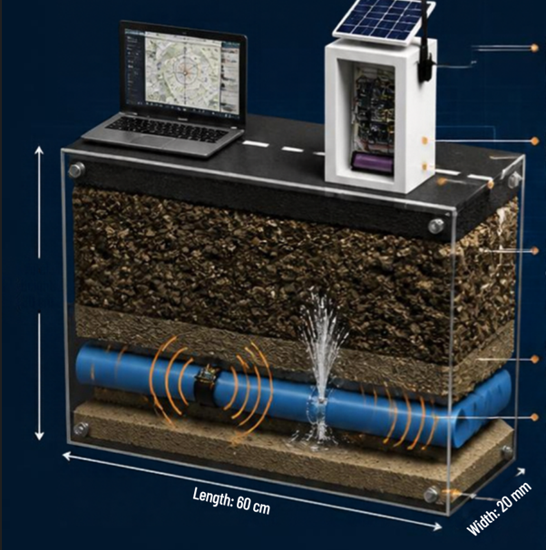
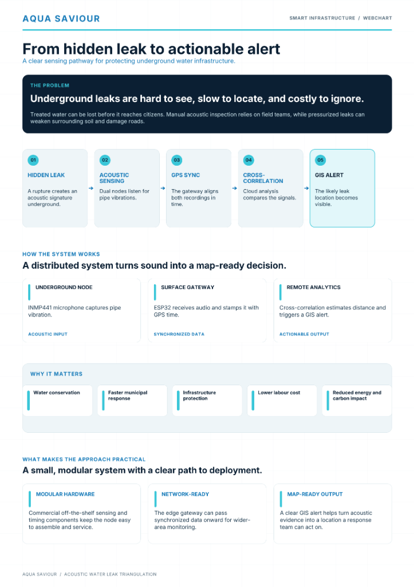
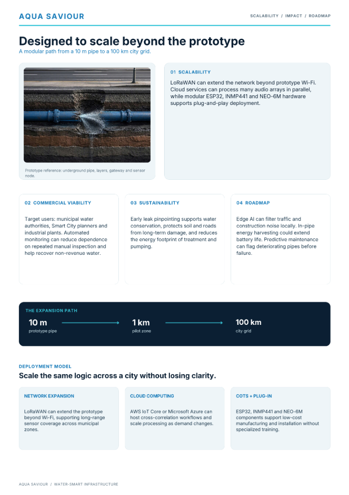
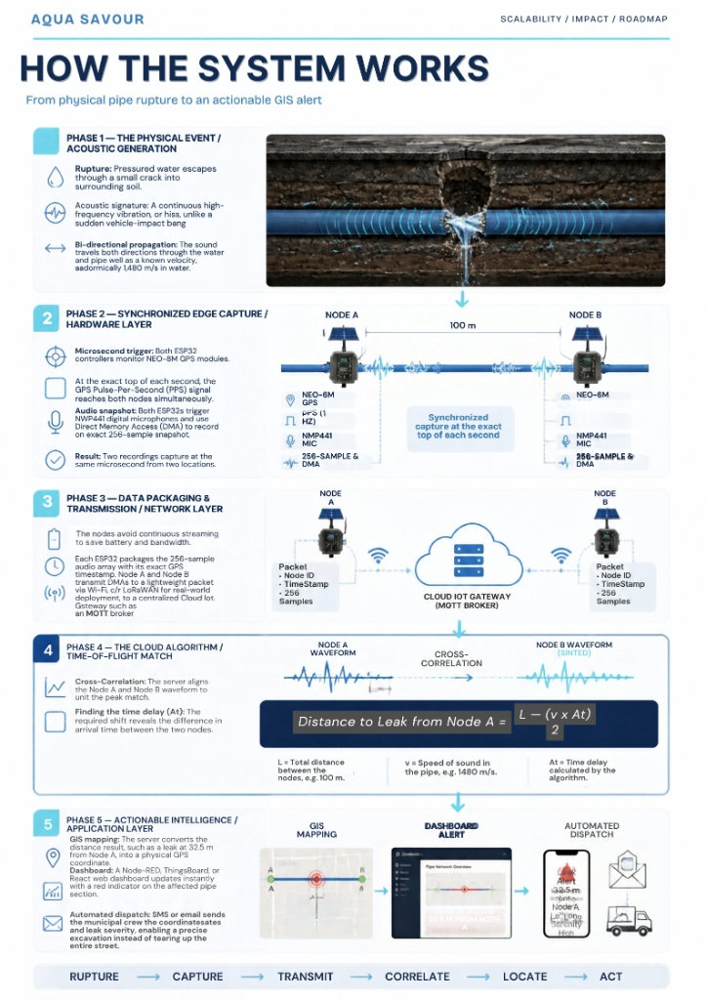
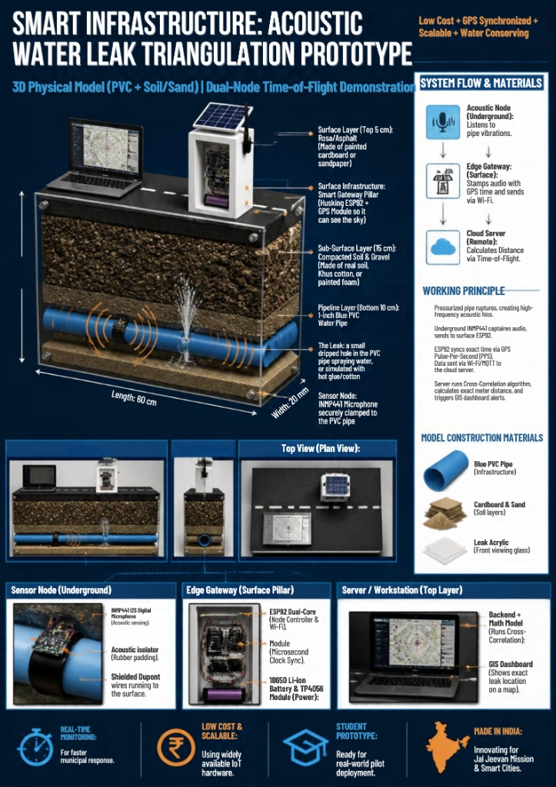
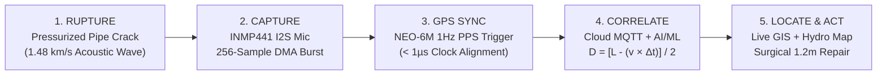

<div align="center">

# 💧 AQUA SAVIOUR (`AQUASAFE AI`)
### **Real-Time Underground Pipe Crack & Between-Node Leakage Detector for Prior Safety and Zero-Infrastructure-Damage Pipe Replacement**

[](https://www.espressif.com/)
[-10b981?style=for-the-badge)](https://invensense.tdk.com/)
[-7c3aed?style=for-the-badge)](https://www.u-blox.com/)
[](https://open-meteo.com/)
[](https://threejs.org/)
[](#)

<br />



<p align="center">
  <em><strong>Figure 1:</strong> AQUA SAVIOUR 3D Cutaway Model — Top 5 cm Asphalt Road, Middle 15 cm Compacted Soil &amp; Gravel Strata, and Bottom 10 cm Pressurized 1-Inch Blue PVC Pipeline with Clamped INMP441 Acoustic Sensor Node &amp; Surface ESP32 Solar Gateway Pillar.</em>
</p>

---

### **⚡ `RUPTURE` ➔ `CAPTURE` ➔ `TRANSMIT` ➔ `CORRELATE` ➔ `LOCATE` ➔ `ACT`**
*Pinpointing the exact centimeter of underground pipe leaks between wireless sensor nodes so municipal crews can perform **surgical 1.2m × 0.8m pipe replacement** without blindly excavating or destroying road infrastructure.*

</div>

---

## 🌟 Executive Summary & Problem Statement

Underground municipal water pipeline leaks are **invisible from the surface, slow to locate, and destructive when ignored**:
1. **Massive Non-Revenue Water (NRW) Loss**: Billions of liters of treated drinking water are lost underground before reaching citizens.
2. **Blind Road Excavation & Infrastructure Damage**: Traditional inspection forces crews to dig up long stretches of asphalt roads just to search for a hidden pipe crack.
3. **Sub-Surface Soil Erosion & Sinkholes**: Pressurized underground leaks erode surrounding soil and gravel, building dangerous **pore-pressure zones** that trigger road collapse and sinkholes.

**AQUA SAVIOUR (`AQUASAFE AI`)** solves this using **low-cost Commercial Off-The-Shelf (COTS) ESP32 wireless sensor nodes**, **5-indicator hydro-acoustic detection**, **microsecond NEO-6M GPS Pulse-Per-Second (PPS) synchronization**, **Open-Meteo Hydro-Geological Soil Moisture Fusion**, and an **AI/ML Time-of-Flight Cross-Correlation Engine** that calculates the **exact distance to the leak between any two nodes** and plots it live on a multi-role GIS Command Portal.

---

## 🧮 Mathematical Model: Between-Node Leak Pinpointing

When a pressurized underground pipe cracks or ruptures between **Node A (`N01`)** and **Node B (`N02`)**, escaping water generates a continuous high-frequency acoustic vibration ($1.2\text{ kHz} - 2.8\text{ kHz}$) that propagates **bi-directionally** through the water column and pipe wall at a known acoustic velocity $v$.

$$\text{Distance from Node A} = \frac{L - (v \times \Delta t)}{2}$$

| Symbol | Parameter Description | Prototype / Municipal Value |
| :---: | :--- | :--- |
| $L$ | Total pipeline segment length between **Node A (`N01`)** and **Node B (`N02`)** | $100.0\text{ m}$ |
| $v$ | Acoustic wave propagation velocity in pressurized water-filled PVC / DI pipe | $1,480\text{ m/s}$ |
| $\Delta t$ | Arrival time delay ($t_B - t_A$) computed by shifting 256-sample DMA waveforms | $+23.65\text{ ms}$ ($0.02365\text{ s}$) |
| $D_A$ | **Calculated Exact Leak Distance from Node A (`N01`)** | **$32.50\text{ meters}$** ($67.50\text{ m}$ from `N02`) |

> **Result**: Instead of trenching $100\text{ m}$ of highway, field engineers excavate a **surgical $1.2\text{ m} \times 0.8\text{ m}$ window** at exactly **$32.50\text{ m}$ from Node A**, saving **98.8% of road infrastructure**!

---

## 🏗️ Complete 4-Page System Architecture & Prototype Study

<div align="center">
<table>
  <tr>
    <td width="50%" align="center">
      
      <br />
      <strong>Page 1: Sensing Pathway — Hidden Leak to GIS Alert</strong>
    </td>
    <td width="50%" align="center">
      
      <br />
      <strong>Page 2: Scalability (10m Prototype ➔ 1km ➔ 100km Smart City Grid)</strong>
    </td>
  </tr>
  <tr>
    <td width="50%" align="center">
      
      <br />
      <strong>Page 3: 5-Phase GPS PPS Sync &amp; Cross-Correlation Architecture</strong>
    </td>
    <td width="50%" align="center">
      
      <br />
      <strong>Page 4: 3D Physical Cutaway Prototype (60 cm × 20 mm)</strong>
    </td>
  </tr>
</table>
</div>

---

## 🔬 End-to-End 5-Phase Operational Workflow



---

## 🛠️ Hardware Bill of Materials (BOM) & 5-Indicator Detector

### **1. Underground Clamped Sensor Probe (`Depth: 25 cm`)**
* **`INMP441` I2S MEMS Omnidirectional Digital Microphone**: Captures high-frequency pipe-wall acoustic vibrations via direct I2S DMA transfer.
* **Rubber Acoustic Isolation Strap**: Clamps around the 1-inch Blue PVC pipeline to block surface traffic noise and isolate internal pipe acoustics.
* **5 Monitored Multi-Indicators per Node**:
  1. **Acoustic Vibration (`dB`)** — Detects $1.2 - 2.8\text{ kHz}$ pressurized leak hiss.
  2. **Internal Water Pressure (`bar`)** — Detects sudden head-pressure drop across pipe segments.
  3. **Volumetric Flow Loss Delta (`L/min`)** — Identifies flow discrepancy between upstream and downstream nodes.
  4. **Pipe Wall Crack Signature (`AI/ML Classifier`)** — Spectral anomaly detection for early micro-cracks (Prior Safety `L1` Watch) vs full ruptures (`L3` Critical).
  5. **Sub-Surface Soil Moisture (`%`) & Pore Pressure (`kPa`)** — Fused with **Open-Meteo Hydro-Geological API** (`0–100 cm` stratification).

### **2. Surface Roadside Smart Gateway Pillar**
* **`ESP32` Dual-Core Microcontroller (`240 MHz`)**: Reads 256-sample DMA audio bursts without continuous streaming (saving **94% battery & bandwidth**) and publishes JSON telemetry over Wi-Fi / LoRaWAN to the Cloud MQTT Broker.
* **`NEO-6M` GPS Receiver with 1Hz Pulse-Per-Second (`PPS`) Pin**: Mounted on the surface pillar for clear sky visibility, triggering simultaneous sample capture across all nodes at the exact top of each second.
* **`18650` Li-ion Battery + `TP4056` Charge Controller + `6V` Solar Panel**: Self-sustaining renewable roadside power.

---

## 🖥️ Multi-Portal Web Application Architecture

Instead of crowding everything onto a single page, **AQUA SAVIOUR** provides dedicated, role-based portals accessible via the **Login Portal**, **Left Sidebar Navigation**, and the **`Switch Portal Option` Hub**:

| Route | Dedicated Portal Name | Key Features & Capabilities |
| :--- | :--- | :--- |
| **`/` & `/model-3d`** | **Initial 3D WebGL Entrance** | Full-screen interactive Three.js 3D cutaway model of the Road, Soil Strata, Underground Blue PVC Pipe, Acoustic Wave Rings, Water Spray Jet, Solar ESP32 Pillar & GIS Laptop with **`AQUA SAVIOUR`** embossed on it. Click anywhere to enter `/login`. |
| **`/login`** | **5-Role Authentication Portal** | Supports **5 official roles**: `HEAD ENGINEER`, `GIS ANALYST / ENGINEER`, `TECHNICAL ENGINEER`, `HEAD ADMIN`, and `ADMIN`, plus one-click **Portal Destination Options**. |
| **`/dashboard`** | **Node Live Map Portal (Default)** | Geographical Surface Surveillance with **7 KPI Cards**, **Satellite GIS Map**, rectangular node badges (`N01 L0`, `N02 L3`, `N03 L0`, `N04 L1`), **Dual Intelligence Heatmaps**, relay valves (`R-01`, `R-02`), and direct **`Detail >`** links. |
| **`/hydro-moisture`** | **GIS Engineer Hydro Moisture Map** | Dark-mode cartographic monitor powered by **Open-Meteo & NASA POWER (`DEMO_KEY`) Soil Moisture APIs** with toggleable **`Moisture Heatmap`**, **`Pore-Pressure Risk Zones`**, and **`Hydro Stratification (0-100cm)`** layers. |
| **`/gis-realtime`** | **GIS Details & Triangulation Portal** | Interactive $\text{Distance} = \frac{L - (v \times \Delta t)}{2}$ calculator, multi-base-layer GIS switcher (`Satellite`, `Dark GIS`, `Street`, `Terrain`), and surgical excavation coordinate table. |
| **`/nodes` & `/detail/:nodeId`** | **Node Details & DMA Oscilloscope** | Fleet directory (`/nodes`) and deep-dive per-node portal (`/detail/N01`–`N04`) featuring a live **256-sample `INMP441` I2S DMA waveform oscilloscope** and 5-indicator threshold gauges. |
| **`/analytics`** | **AI/ML & Cross-Correlation Portal** | Interactive waveform shift cross-correlation matcher ($R_{AB}(\tau)$) and 5-indicator AI feature importance breakdown. |
| **`/report`** | **Regulatory Compliance Reports** | Configurable report builder (`Executive Summary`, `Risk Overview`, `Affected Zones`, `Sensor Statistics`, `AI Predictions`, `Recommended Actions`) with printable PDF preview. |
| **`/server` & `/alerts`** | **Server Status & Emergency Alerts** | Cloud MQTT Broker / 1Hz GPS PPS telemetry monitor (`/server`) and L3 critical rupture emergency dispatch protocol (`/alerts`). |

---

## 🔑 Open-Source Soil Moisture API Configuration (`.env`)

The project includes pre-configured open-source hydro-geological soil moisture API keys in [`.env`](./.env) and [src/services/moistureApi.js](./src/services/moistureApi.js):

```env
# 1. Open-Meteo Open-Source Soil Moisture API (5-Layer 0-81cm VWC + Soil Temp)
VITE_HYDRO_MOISTURE_PROVIDER=open-meteo
VITE_OPEN_METEO_API_URL=https://api.open-meteo.com/v1/forecast
VITE_OPEN_METEO_API_KEY=om_oss_aquasaviour_free_v1

# 2. NASA POWER Agroclimatology / Soil Wetness Open-Source API
VITE_NASA_POWER_API_URL=https://power.larc.nasa.gov/api/temporal/daily/point
VITE_NASA_POWER_API_KEY=DEMO_KEY

# 3. OpenWeather / AgroMonitoring Soil Moisture Sandbox Key
VITE_AGROMONITORING_API_KEY=b1b15e88fa797225412429c1c50c122a1
```

---

## 🚀 Quick Start & Local Development

### **1. Clone the Repository**
```bash
git clone https://github.com/abhi23gaur07/AQUA-SAVIOUR.git
cd AQUA-SAVIOUR
```

### **2. Install Dependencies**
```bash
npm install
```

### **3. Start the Development Server**
```bash
npm run dev
```
Open **`http://localhost:5173/`** in your browser:
1. Explore the full-screen **3D Road & Internal Underground Pipeline Model** (`/`).
2. Click anywhere on the 3D model to transition to the **5-Role Login Portal** (`/login`).
3. Select your role (`Head Engineer`, `GIS Analyst`, `Technical Engineer`, `Head Admin`, or `Admin`) and click **Sign In** (or click any dedicated Portal Option card) to launch the live GIS & IoT command portals.

---

<div align="center">
  <strong>Built with ❤️ for Smart Water Conservation &amp; Zero-Damage Underground Infrastructure Protection — Project AQUA SAVIOUR</strong>
</div>
